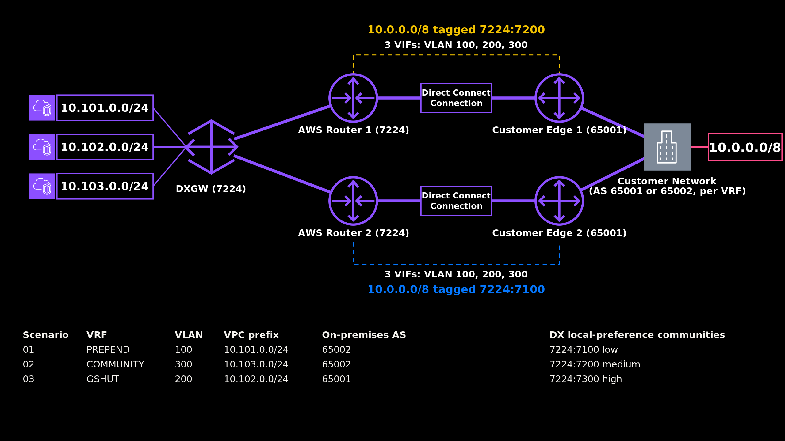

# NET301: See the routes change: Live BGP with AWS Direct Connect

Configuration from the AWS re:Invent 2026 session NET301. It shows how a customer network can react
to AWS Direct Connect maintenance signals in BGP, and how a customer can move traffic between two
Direct Connect connections on its own.

This repository contains Junos configuration only. It does not include a lab environment, software
images or automation. Build the topology on any platform you choose and load the configurations.

> This is sample code, for non-production usage. You should work with your security and legal teams
> to meet your organizational security, regulatory and compliance requirements before deployment.

## What is in this repository

| Path | Contents |
|---|---|
| `configs/customer-edge-1.conf` | Customer edge router on the primary Direct Connect connection |
| `configs/customer-edge-2.conf` | Customer edge router on the backup Direct Connect connection |
| `configs/customer-network.conf` | The customer's on-premises network. Observation only. |
| `configs/aws-router-1.conf` | Stands in for the AWS side of the primary connection |
| `configs/aws-router-2.conf` | Stands in for the AWS side of the backup connection |
| `configs/dxgw.conf` | Stands in for the AWS network behind the connections (VPC prefixes). Observation only. |
| `images/topology.png` | Topology diagram from the session |
| `PHASES.md` | The configuration change for each step of the demo, and what to check after it |

The AWS-side configurations (`aws-router-1`, `aws-router-2`, `dxgw`) are a simplified model written
for this session so the customer side has something to peer with. They are not how AWS implements
Direct Connect. The customer-side configurations are the part you can adapt to your own network.

## Topology



```
VPC prefixes                                                            On-premises
10.101-103.0.0/24                                                       10.0.0.0/8

            +-- AWS Router 1 ==(3 VIFs)== Customer Edge 1 --+
DXGW -------+                                               +------- Customer Network
            +-- AWS Router 2 ==(3 VIFs)== Customer Edge 2 --+

AWS: AS 7224                 Customer: AS 65001 (AS 65002 on-premises in PREPEND and COMMUNITY)
```

Each Direct Connect connection carries three VIFs (VLANs 100, 200, 300). Each VIF belongs to one
VRF, and each VRF shows one way a customer can react to maintenance on AWS Router 1.

| Scenario | VRF | VLAN | VPC prefix | The customer reacts to | Traffic moves by |
|---|---|---|---|---|---|
| 01 | PREPEND | 100 | 10.101.0.0/24 | AWS prepending AS 7224 three times | AS path length (no customer policy) |
| 02 | COMMUNITY | 300 | 10.103.0.0/24 | maintenance community 7224:2200 | prepending its own AS five times |
| 03 | GSHUT | 200 | 10.102.0.0/24 | graceful-shutdown community 65535:0 (RFC 8326) | local-preference 0 |

Scenario numbers follow the session slides. VLANs and prefixes follow the order the VRFs were
built, so scenario 02 uses VLAN 300 and 10.103.0.0/24.

The maintenance community can drive any action in the customer's policy. COMMUNITY uses it to
prepend; local-preference or MED would work the same way in a network where they apply.

In GSHUT the customer edges and the Customer Network run iBGP in one AS, so a
local-preference set on an edge applies across the customer network. In PREPEND and COMMUNITY the
on-premises network is a separate AS (65002) and runs eBGP to the edges, so local-preference does not
cross that boundary and AS path length is the lever.

## Addressing

| Link | Subnets | Addresses |
|---|---|---|
| AWS Router 1 to Customer Edge 1 | 10.1.1-3.0/30 (VLAN 100-300) | Customer Edge 1 .1, AWS Router 1 .2 |
| AWS Router 2 to Customer Edge 2 | 10.2.1-3.0/30 (VLAN 100-300) | Customer Edge 2 .1, AWS Router 2 .2 |
| Customer Edge 1 to Customer Network | 10.21.1-3.0/30 (VLAN 100-300) | Customer Edge 1 .1, Customer Network .2 |
| Customer Edge 2 to Customer Network | 10.22.1-3.0/30 (VLAN 100-300) | Customer Edge 2 .1, Customer Network .2 |
| AWS Router 1 to DXGW | 10.10.1.0/30 | AWS Router 1 .1, DXGW .2 |
| AWS Router 2 to DXGW | 10.10.2.0/30 | AWS Router 2 .1, DXGW .2 |

Interface names in the configurations are `eth1` and `eth2`. Rename them to match your platform.

## Steady state

- Toward AWS, Customer Edge 1 tags 10.0.0.0/8 with 7224:7200 (medium preference) and Customer Edge 2
  with 7224:7100 (low preference), so AWS sends traffic through Customer Edge 1.
- Toward on-premises, Customer Edge 1 is preferred: local-preference 150 against 100 in GSHUT,
  and a shorter AS path in PREPEND and COMMUNITY.

`PHASES.md` walks through maintenance on AWS Router 1 in two stages, the return to service in two
stages, and a customer-initiated failover to Customer Edge 2.

## Security

See [CONTRIBUTING](CONTRIBUTING.md#security-issue-notifications) for more information.

## License

This sample is licensed under the MIT-0 License. See the [LICENSE](LICENSE) file.
